# cu-wifi-connect

สคริปต์ตั้งค่า **ChulaWiFi** และ **eduroam** (จุฬาลงกรณ์มหาวิทยาลัย) บน Linux ผ่าน NetworkManager
มีหน้าจอเมนูในเทอร์มินัล แค่เลือกเครือข่าย กรอกรหัสนิสิตและรหัสผ่าน CUNet ก็ใช้งานได้

> Set up ChulaWiFi / eduroam (Chulalongkorn University) on Linux with NetworkManager. [English quick start](#english-quick-start)

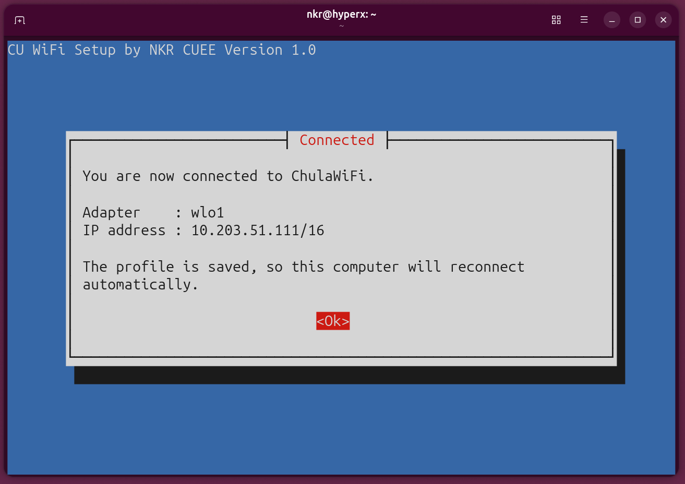

## ทำไมต้องใช้สคริปต์นี้

ระบบยืนยันตัวตนของมหาวิทยาลัยใช้ PEAP/MSCHAPv2 กับ TLS รุ่นเก่า ซึ่ง OpenSSL 3 ใน distro รุ่นใหม่ (เช่น Ubuntu 22.04 ขึ้นไป) ปิดไว้เป็นค่าเริ่มต้น
หน้าตั้งค่า WiFi แบบ GUI ไม่มีช่องให้เปิดค่าเหล่านี้ จึงกรอกรหัสถูกแล้วก็ยังต่อไม่ติด สคริปต์นี้สร้างโปรไฟล์ NetworkManager พร้อมค่าที่จำเป็นให้ครบในครั้งเดียว

ความสามารถ:

- เลือกได้ทั้ง ChulaWiFi และ eduroam (เติม `@eduroam.chula.ac.th` ให้อัตโนมัติ)
- สแกนหาสัญญาณและแสดงความแรงก่อนบันทึก ถ้าไม่อยู่ในพื้นที่ก็บันทึกโปรไฟล์ไว้ก่อนได้
- หน้ายืนยันข้อมูลก่อนบันทึก
- ต่อไม่สำเร็จ เลือกได้ว่าจะกรอกใหม่ เก็บโปรไฟล์ไว้ หรือลบทิ้ง
- รองรับเครื่องที่มีการ์ด WiFi หลายใบ และเปิด WiFi ให้ถ้าปิดอยู่
- ตั้งค่า `openssl-ciphers` ให้อัตโนมัติเมื่อใช้ NetworkManager 1.48 ขึ้นไป

## สิ่งที่ต้องมี

- Linux ที่ใช้ **NetworkManager** (มีคำสั่ง `nmcli`)
- **whiptail** หรือ **dialog**
- รหัสนิสิต/รหัสบุคลากร และรหัสผ่าน CUNet

ติดตั้ง whiptail (ถ้ายังไม่มี):

```bash
sudo apt install whiptail      # Debian / Ubuntu / Mint
sudo dnf install newt          # Fedora / RHEL
sudo zypper install newt       # openSUSE
sudo pacman -S libnewt         # Arch
```

> อย่าใช้ร่วมกับการจัดการ WiFi ด้วย wpa_supplicant, iwd หรือ netplan แบบแยกต่างหาก

## การติดตั้งและใช้งาน

```bash
git clone https://github.com/myelosoft/cu-wifi-connect.git
cd cu-wifi-connect
chmod +x cu-wifi-connect.sh
./cu-wifi-connect.sh
```

ไม่ต้องใช้ `sudo` ในการรัน ดูตัวเลือกได้ด้วย `./cu-wifi-connect.sh --help`

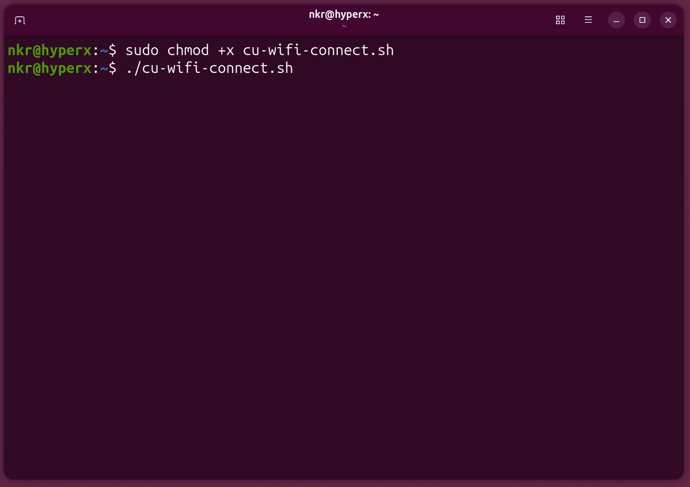

### ChulaWiFi

| ขั้นตอน | หน้าจอ |
| --- | --- |
| 1. เลือก **ChulaWiFi** ด้วยลูกศร แล้วกด Enter | 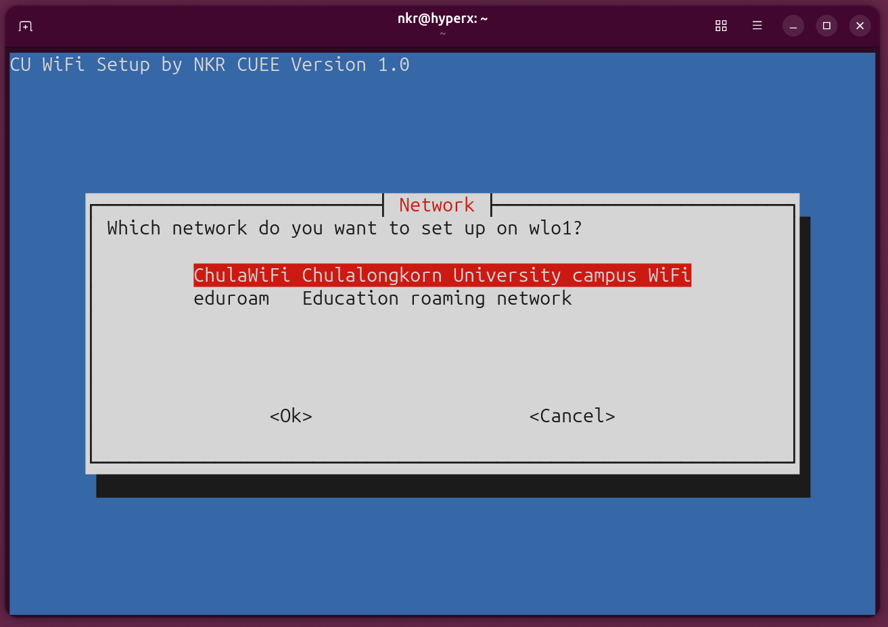 |
| 2. กรอกรหัสนิสิต/รหัสบุคลากร (ตัวเลขอย่างเดียว) | 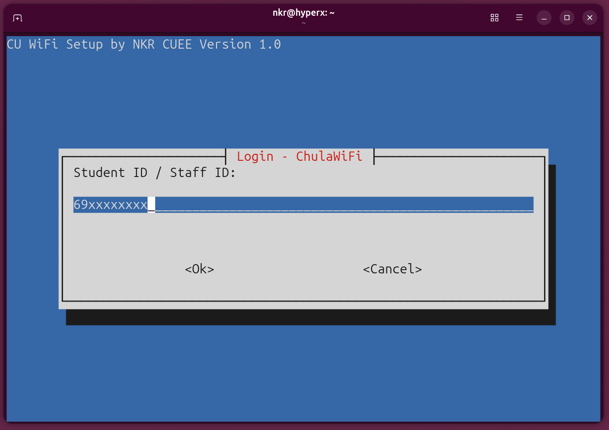 |
| 3. กรอกรหัสผ่าน CUNet | 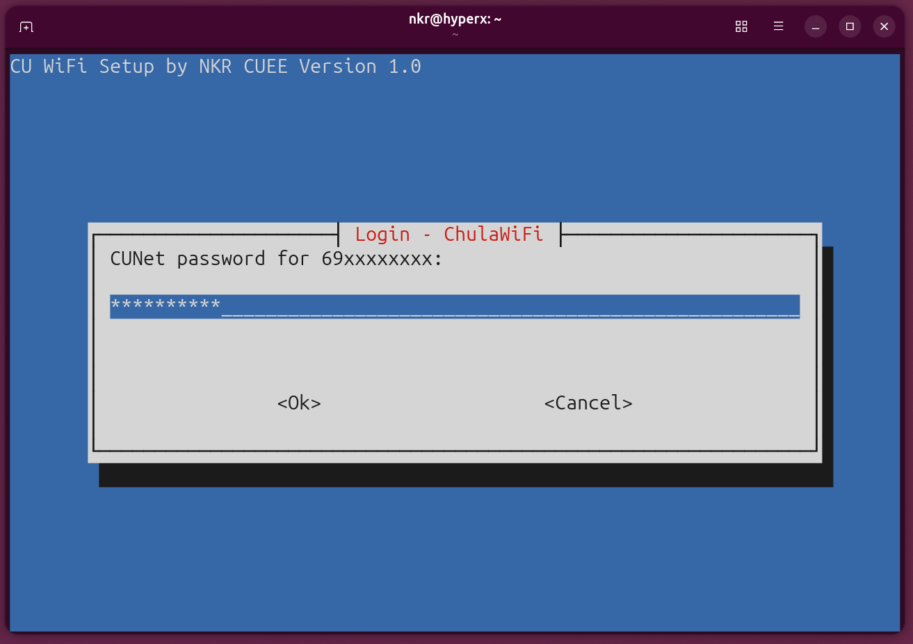 |
| 4. ตรวจสอบข้อมูล แล้วเลือก **Yes** |  |
| 5. รอเชื่อมต่อ (ไม่เกิน 45 วินาที) | 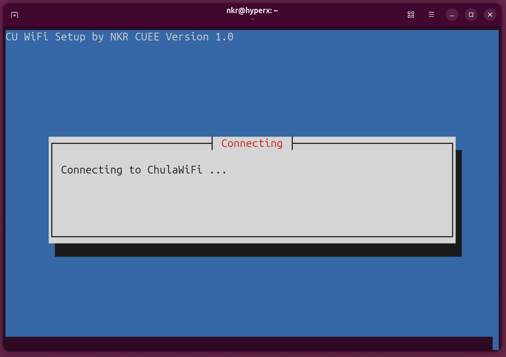 |
| 6. เชื่อมต่อสำเร็จ พร้อม IP address |  |
| 7. กลับมาที่เทอร์มินัล | 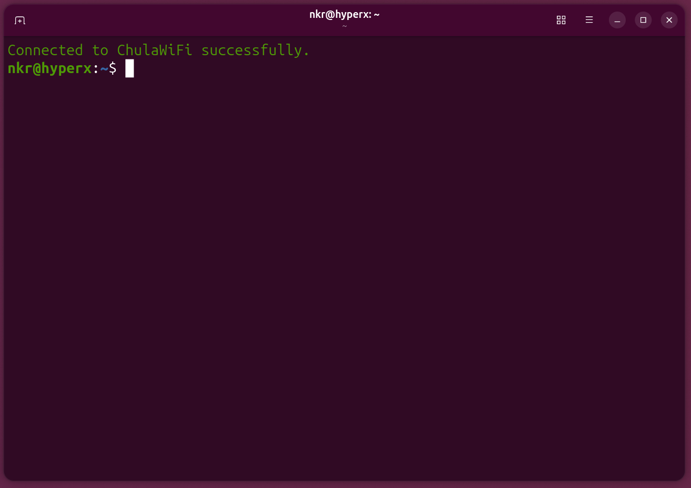 |

ครั้งต่อไปเครื่องจะต่อให้อัตโนมัติ ไม่ต้องรันสคริปต์ซ้ำ

### eduroam

รันสคริปต์อีกครั้ง ขั้นตอนเหมือน ChulaWiFi ต่างกันตรงที่กรอกเฉพาะรหัสนิสิต สคริปต์จะเติม `@eduroam.chula.ac.th` ให้เอง

| ขั้นตอน | หน้าจอ |
| --- | --- |
| 1. เลือก **eduroam** | 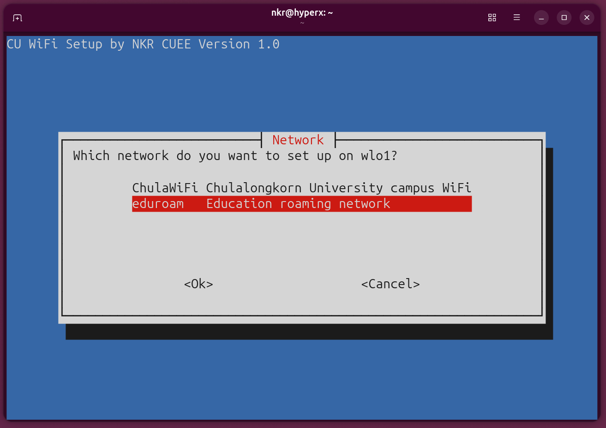 |
| 2. สคริปต์สแกนหาสัญญาณ | 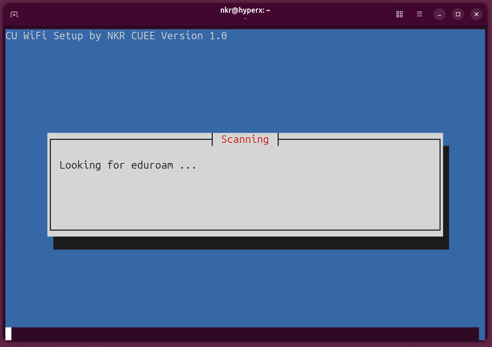 |
| 3. กรอกรหัสนิสิต (ไม่ต้องใส่ @...) | 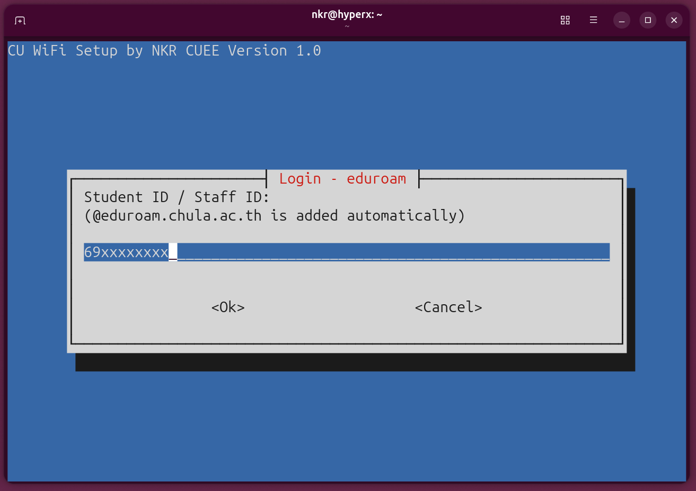 |
| 4. กรอกรหัสผ่าน CUNet | 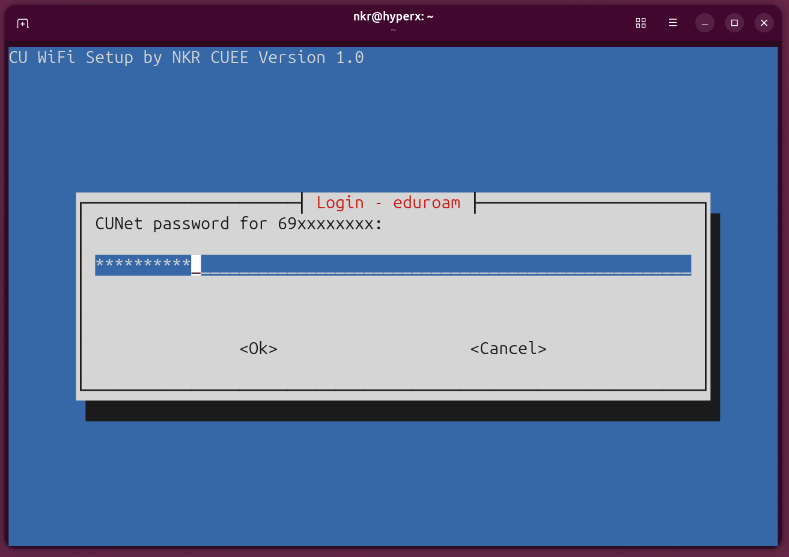 |
| 5. ตรวจสอบว่า Username มี `@eduroam.chula.ac.th` แล้วเลือก **Yes** | 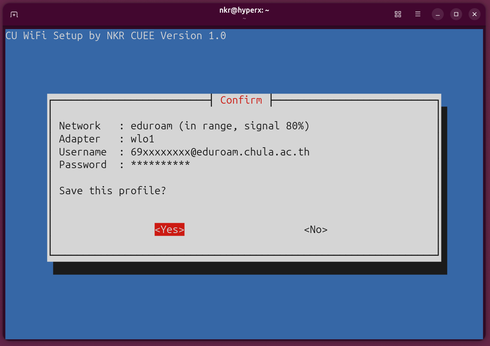 |
| 6. รอเชื่อมต่อ |  |

## แก้ปัญหา

ถ้ารหัสผ่านผิด ระบบ desktop (เช่น GNOME) อาจเด้งหน้าต่าง **Authentication required** ขึ้นมา แนะนำให้กด **Cancel** แล้วให้สคริปต์จัดการต่อ

| หน้าต่างจาก GNOME | ข้อความ error | เมนูหลังต่อไม่สำเร็จ |
| --- | --- | --- |
| 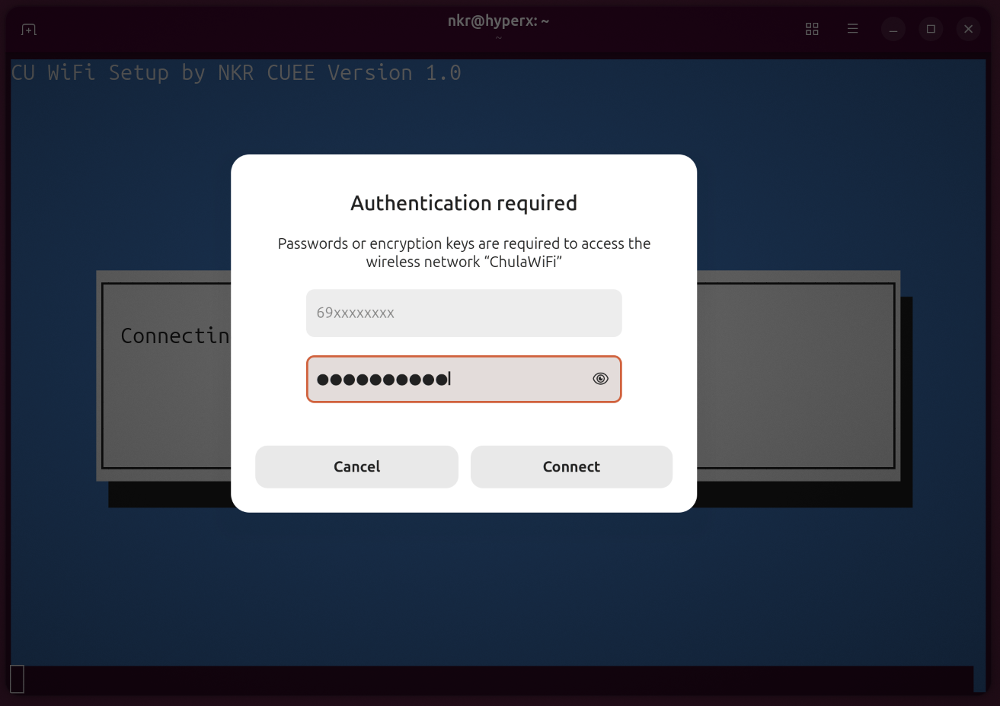 | 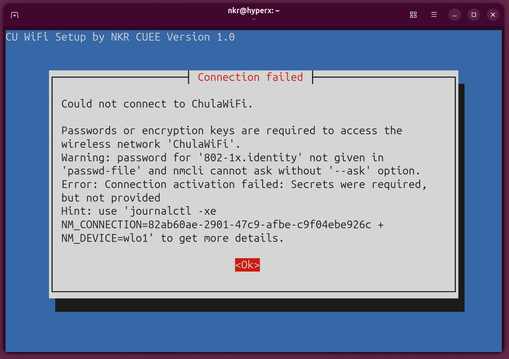 | 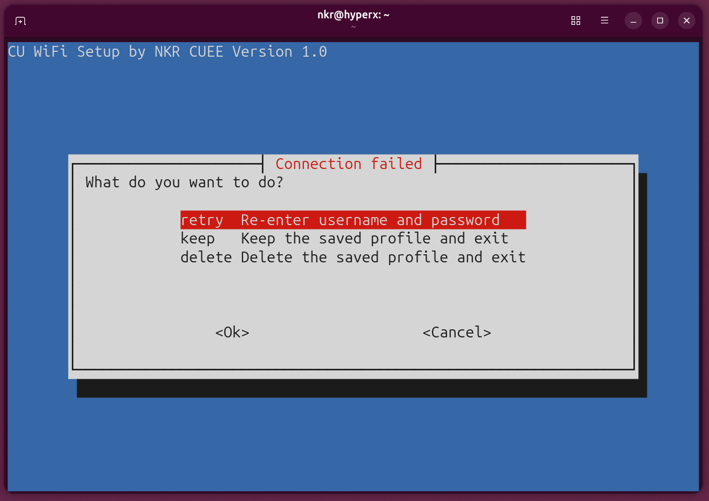 |

เมนูหลังต่อไม่สำเร็จ: **retry** กรอกใหม่ · **keep** เก็บโปรไฟล์แล้วออก · **delete** ลบโปรไฟล์แล้วออก

| อาการ | วิธีแก้ |
| --- | --- |
| `Secrets were required, but not provided` | รหัสนิสิตหรือรหัสผ่านผิด ลองล็อกอินด้วยรหัสเดียวกันบนมือถือ |
| `... was not found nearby` | ขยับเข้าใกล้จุดปล่อยสัญญาณ หรือบันทึกโปรไฟล์ไว้ก่อน |
| `nmcli not found` | เครื่องไม่ได้ใช้ NetworkManager |
| `whiptail (or dialog) not found` | ติดตั้ง whiptail ตามหัวข้อสิ่งที่ต้องมี |
| ต่อได้แต่หลุดบ่อย | `journalctl -u NetworkManager -n 50` |

ลบโปรไฟล์:

```bash
nmcli connection delete ChulaWiFi
nmcli connection delete eduroam
```

## ค่าที่สคริปต์ตั้งให้

| ค่า | ค่าที่ใช้ |
| --- | --- |
| `wifi-sec.key-mgmt` | `wpa-eap` |
| `802-1x.eap` | `peap` |
| `802-1x.phase2-auth` | `mschapv2` |
| `802-1x.phase1-auth-flags` | `32` (อนุญาต TLS 1.0) |
| `802-1x.openssl-ciphers` | `DEFAULT@SECLEVEL=0` (NetworkManager 1.48 ขึ้นไป) |
| Identity สำหรับ eduroam | `<รหัสนิสิต>@eduroam.chula.ac.th` |

## ความปลอดภัย

ค่าข้างต้นจำเป็นเพื่อให้เข้ากับระบบของมหาวิทยาลัย แต่มีข้อแลกเปลี่ยนที่ควรรู้:

- **ไม่ตรวจสอบใบรับรองของเซิร์ฟเวอร์** (ไม่ได้ตั้ง CA certificate) access point ปลอมที่ใช้ชื่อเดียวกันอาจดักข้อมูลล็อกอินได้ ควรใช้รหัสผ่าน CUNet ที่ไม่ซ้ำกับบริการอื่น
- **TLS 1.0 และ SECLEVEL=0** มีผลเฉพาะโปรไฟล์ WiFi นี้ ไม่กระทบการเชื่อมต่ออื่น
- **รหัสผ่านถูกส่งให้ `nmcli` ทาง command line** ผู้ใช้อื่นบนเครื่องเดียวกันอาจเห็นได้ชั่วขณะผ่าน `ps`
- รหัสผ่านเก็บใน `/etc/NetworkManager/system-connections/` ซึ่งอ่านได้เฉพาะ root

## English quick start

Requirements: NetworkManager (`nmcli`) and `whiptail` or `dialog`.

```bash
git clone https://github.com/myelosoft/cu-wifi-connect.git
cd cu-wifi-connect
chmod +x cu-wifi-connect.sh
./cu-wifi-connect.sh
```

Pick **ChulaWiFi** or **eduroam**, enter your Student/Staff ID and CUNet password, confirm, and wait for the connection. For eduroam, `@eduroam.chula.ac.th` is appended automatically. The profile is saved, so the machine reconnects on its own next time.

Note: the profile uses PEAP/MSCHAPv2 with TLS 1.0 allowed and `SECLEVEL=0`, and does **not** verify the server certificate. See [ความปลอดภัย](#ความปลอดภัย) above.

## เครดิต

- ปรับปรุงจาก CU-WiFi-Connection ตัวต้นฉบับ (ส่วนแก้ TLS โดย @unwraps)
- CU WiFi Setup by NKR CUEE
